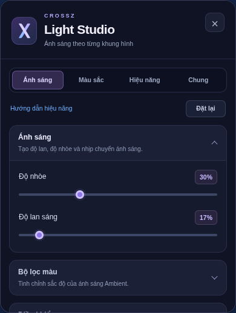

# CrossZ Light Studio — 0.1.2

Bảng điều khiển ánh sáng dùng nền tối, điểm nhấn tím và xanh dương, logo X riêng và các nhóm dạng thẻ. Nhóm Ánh sáng và Màu sắc được đặt trước để dễ tìm. Toàn bộ tên 88 mục cài đặt được Việt hóa; một số mô tả kỹ thuật chuyên sâu vẫn giữ tiếng Anh.

Ảnh chụp giao diện thực được render trong fixture kiểm thử, không phải ảnh chạy trên YouTube trực tiếp.

## Sử dụng

- Bấm biểu tượng X trong thanh điều khiển video hoặc **Cài đặt ánh sáng nâng cao** ở popup CrossZ để mở bảng.
- Các nút Ánh sáng, Màu sắc, Hiệu năng và Chung chuyển nhanh đến nhóm tương ứng. Bấm tiêu đề nhóm để mở/thu gọn.
- Thanh trượt vẫn thay đổi hiệu ứng ngay; bấm vào giá trị để nhập số. Nhấp chuột phải vào tùy chỉnh để đặt lại giá trị đó.
- Dùng Tab để di chuyển, Enter/Space để kích hoạt nhóm hoặc công tắc, phím mũi tên để chỉnh thanh trượt.
- Nút × hoặc Escape đóng bảng và đưa focus về nút X. Khi đang nhập giá trị số, Escape hủy phần nhập chưa áp dụng; khi đang sửa phím tắt, Escape vẫn dùng để bỏ phím tắt đó.
- **Đặt lại** vẫn yêu cầu xác nhận trước khi xóa cài đặt ánh sáng và tải lại video. Nhập/xuất cấu hình tiếp tục ở **CrossZ → Cấu hình**.

## Tương thích

Các khóa, giá trị đã lưu và định dạng nhập/xuất Ambient được giữ nguyên. Bố cục nhóm thay đổi trong giao diện; renderer, bộ chặn quảng cáo, âm thanh và quyền extension không đổi. Không thêm font, script hoặc dịch vụ mạng bên ngoài.

Panel co theo chiều rộng player và giới hạn chiều cao để có thể cuộn. Cần kiểm tra thêm trên Edge/YouTube thực tế, đặc biệt fullscreen và video nhúng, vì trình duyệt cloud hiện cấm cài unpacked. Giấy phép và ghi công MIT được giữ ở [THIRD_PARTY_NOTICES.md](../THIRD_PARTY_NOTICES.md).
